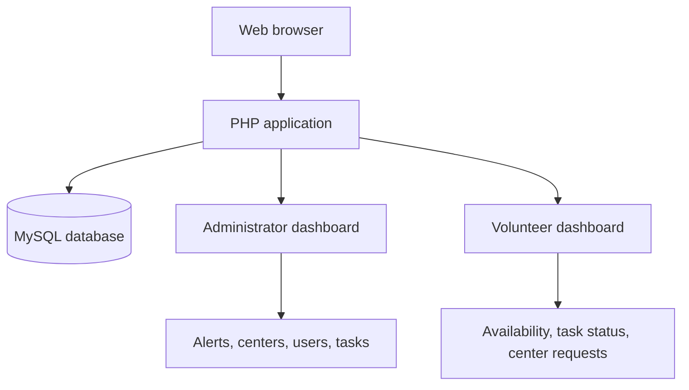

# Province of Leyte — Disaster Preparedness and Response Portal

**Academic project | PHP · MySQL · HTML · CSS · JavaScript**

A browser-based prototype for coordinating disaster preparedness and response activities through separate **administrator** and **volunteer** dashboards. Administrators can post alerts, manage evacuation centers, organize volunteers, and assign response tasks. Volunteers can review alerts, update their availability, view assigned tasks, and request assignment to evacuation centers.

> [!IMPORTANT]
> **Student/portfolio project — not an official Province of Leyte government service.** This prototype is not connected to emergency agencies, does not send emergency SMS or push alerts, and must not be relied upon for real-world disaster response.

## Key features

### Administrator

- **Alerts:** Create and review informational, warning, and critical alerts displayed within the portal.
- **Evacuation centers:** Add, edit, and remove center records with barangay, capacity, and availability status.
- **Volunteer coordination:** Review, approve, or reject volunteers' center assignment requests; directly assign volunteers to centers.
- **Task management:** Create, assign, update, and delete response tasks.
- **User management:** Manage administrator and volunteer accounts.

### Volunteer

- **Personal dashboard:** Update availability (`Available`, `Pre-occupied`, or `Busy`).
- **Alerts:** Review alerts entered by administrators.
- **Assigned tasks:** View tasks and update the status of tasks assigned to the logged-in volunteer.
- **Evacuation centers:** Browse center details and request/cancel participation, subject to administrator approval.

Additional interface features include role-specific navigation and a dark-mode toggle stored in the browser.

## System overview



The application uses server-rendered PHP pages, MySQLi queries, and session-based authentication. It is a traditional PHP web application, not a JavaScript single-page application or a third-party API service.

## Technology stack

| Layer | Technology |
| --- | --- |
| Backend | PHP 8.x and MySQLi |
| Database | MySQL 8.x (or compatible MariaDB) |
| Frontend | HTML, CSS, JavaScript |
| Authentication | PHP sessions and `password_hash()` / `password_verify()` |
| UI dependencies | Google Fonts (Inter), Font Awesome icons via CDN |

## Repository layout

```text
Leyte-Disaster-Response-Portal/
├── README.md
├── .gitignore
├── database/
│   └── schema.sql
├── tools/
│   └── create_admin.php
└── leyte_portal/
    ├── admin/
    │   ├── dashboard.php
    │   ├── manage_alerts.php
    │   ├── manage_centers.php
    │   ├── manage_tasks.php
    │   └── manage_users.php
    ├── volunteer/
    │   ├── dashboard.php
    │   ├── alerts.php
    │   ├── my_tasks.php
    │   └── view_centers.php
    ├── includes/
    ├── config.php
    ├── config.local.example.php
    ├── index.php
    ├── register.php
    ├── logout.php
    └── style.css
```

## Local setup

**Requirements:** PHP 8.x with the `mysqli` extension, MySQL 8.x or compatible MariaDB, and a browser. You can use XAMPP or a local PHP/MySQL installation.

1. **Download or clone** the repository.

   ```bash
   git clone https://github.com/Michael-Kambayashi/Leyte-Disaster-Response-Portal.git
   cd Leyte-Disaster-Response-Portal
   ```

2. **Start MySQL** and import [`database/schema.sql`](database/schema.sql). For example, in a shell with the MySQL CLI:

   ```bash
   mysql -u root -p < database/schema.sql
   ```

   Alternatively, import the SQL file with phpMyAdmin or MySQL Workbench. The schema is a *development reconstruction inferred from the supplied PHP source*, not an original database export. It creates the tables for users, alerts, centers, tasks, and assignments.

3. **Configure the database locally.** Copy:

   `leyte_portal/config.local.example.php` → `leyte_portal/config.local.php`

   Set the correct local database credentials in `config.local.php`. **Never upload that private file**; it is excluded by `.gitignore`. As an alternative, set `LEYTE_DB_HOST`, `LEYTE_DB_USER`, `LEYTE_DB_PASSWORD`, and `LEYTE_DB_NAME` environment variables.

4. **Create a local administrator** from a terminal. First set a strong password (at least 12 characters) using the environment variable `LEYTE_ADMIN_PASSWORD`. Then run:

   ```bash
   php tools/create_admin.php admin "Demo Administrator"
   ```

   Example for PowerShell: `$env:LEYTE_ADMIN_PASSWORD = "choose-your-own-strong-password"` before running the PHP command. For bash: `export LEYTE_ADMIN_PASSWORD='choose-your-own-strong-password'`. Clear the environment variable afterward. The password is intentionally **not** stored in source control.

5. **Start a local development server** from the repository root:

   ```bash
   php -S localhost:8000 -t leyte_portal
   ```

6. Open **http://localhost:8000**. Sign in with your administrator account or use the registration page to create a **volunteer** account for testing.

> **Note:** The PHP built-in server is for local development only. This project has not been deployed or integration-tested as part of this repository preparation.

## Example user flow

1. An administrator creates an evacuation center and publishes a warning or information alert.
2. A volunteer signs in, views the alert, and requests assignment to a center.
3. The administrator reviews and approves the request.
4. The administrator assigns the volunteer a task.
5. The volunteer views the task and updates its status.

## Portfolio and implementation notes

This project demonstrates **CRUD operations, relational data modeling, role-specific dashboards, MySQL integration, session authentication, and a multi-page PHP application**.

For public sharing, the supplied source was minimally adapted to:

- Move local database credentials to an ignored configuration file or environment variables.
- Prevent public registration from directly creating administrator accounts.
- Include a command-line helper for creating a local demonstration administrator.
- Escape dynamic HTML output in key views and add form tokens for POST requests.
- Limit volunteers' task-status updates to their own assigned tasks.
- Add a documented development SQL schema reconstructed from the source code.

## Limitations and next steps

- **Not production-ready:** This is a university/portfolio prototype, not an audited emergency-management system.
- The reconstructed SQL schema and application flow **still need full MySQL-backed testing**.
- No actual emergency-alert delivery system, SMS notifications, GIS/map integration, or live feeds are implemented.
- A production deployment would need deeper security review, authorization tests, rate limiting, monitoring, audit logs, backups, accessibility testing, and operational approvals.
- For a richer GitHub presentation, add screenshots of the administrator and volunteer dashboards using **fictional demo data**.

## Usage and attribution

Created as an academic software project for learning and portfolio demonstration. **No official affiliation with the Provincial Government of Leyte is claimed.** Please respect institutional or collaborator permissions when redistributing academic project material.
